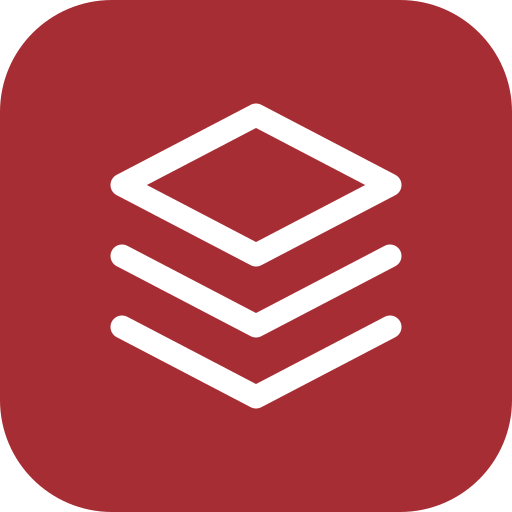
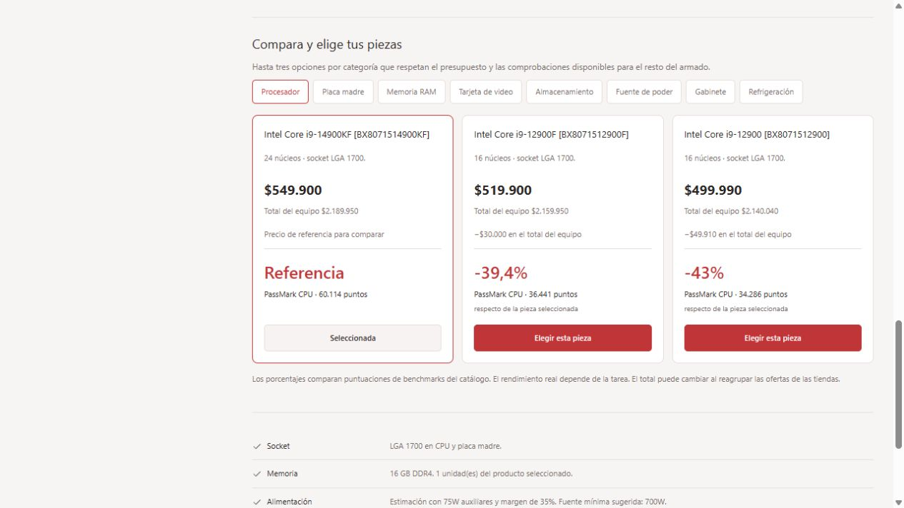

<p align="center">
  
</p>

# Ensamblia


Cotizador de computadores con IA que ayuda a elegir componentes según el uso, el presupuesto y las preferencias de compra.

Ensamblia parte de un problema cotidiano al comprar un PC. Elegir cada pieza requiere comparar especificaciones, comprobar compatibilidad y coordinar ofertas de distintas tiendas. La aplicación propone un armado completo, explica la elección y permite explorar alternativas por componente antes de decidir.

Ensamblia es una **plataforma de cotización entre empresas** en un mismo dominio. El inicio presenta las tiendas disponibles y conduce a un cotizador independiente, donde puedes elegir una o varias empresas. SoloTodo es la fuente inicial para probar catálogos de comercios chilenos; su presencia no implica una alianza comercial. La incorporación de empresas se gestiona directamente, sin un portal empresarial.

**[Probar la demo](https://ensamblia.vercel.app)**

**Demo pública sin IA.** Las cotizaciones se calculan mediante reglas del catálogo, presupuesto y compatibilidad. Puedes explorar las alternativas y cambiar piezas con cero solicitudes a OpenRouter.



## Funciones

- **Cotización por uso y presupuesto.** Perfiles de oficina, hogar y estudio, diseño y edición, videojuegos, y desarrollo y datos. Incluye preferencias de marcas, memoria, almacenamiento, refrigeración, gabinete y WiFi.
- **Hasta tres opciones por categoría.** La pieza seleccionada y hasta dos alternativas que respetan el presupuesto y las comprobaciones disponibles del resto del equipo.
- **Comparaciones con datos del catálogo.** Diferencias de puntuación PassMark para CPU y 3DMark Time Spy para GPU cuando ambos productos tienen datos. En otras categorías se comparan características como capacidad, velocidad de lectura, potencia o conectividad.
- **Ofertas y tiendas.** Precio y enlace por pieza, con la opción de priorizar el menor precio o una compra en menos tiendas dentro del presupuesto.
- **Empresas a tu elección.** Las tiendas elegidas determinan los productos, precios y alternativas disponibles. Puedes entrar al cotizador desde una empresa del inicio.
- **Catálogo diario en Supabase.** Una tarea programada actualiza productos y ofertas a las 09:00 UTC (05:00–06:00 en Chile). Cotizar solo lee la versión guardada y no descarga datos de SoloTodo.
- **Interfaz adaptable.** Tema claro y oscuro, vista móvil y copia de la cotización.

## Cómo funciona

1. **Obtención de datos.** Supabase Cron invoca una ruta protegida de producción una vez al día. El servidor descarga productos y ofertas, conserva tres tiendas piloto por cobertura y publica una versión completa en Postgres. La exclusión diaria evita descargas simultáneas y una transacción conserva el catálogo anterior ante fallos. Las cotizaciones solo leen la versión publicada.
2. **Selección por contexto.** Las reglas clasifican los productos por uso y filtran según presupuesto y preferencias. Un producto puede pertenecer a varios perfiles.
3. **Preparación del armado.** El servidor genera hasta ocho configuraciones con las comprobaciones técnicas disponibles.
4. **Selección según entorno.** Production elige una configuración con reglas y respuestas por uso. La rama Preview estable puede utilizar OpenRouter con configuración de servidor.
5. **Personalización.** El servidor calcula alternativas por categoría. Al cambiar una pieza, vuelve a validar el armado y recalcula ofertas, total y comparaciones utilizando la copia del servidor.

La integración de Preview utiliza `src/lib/openrouter.ts`. Production fuerza el modo demo incluso si el cliente pide IA o queda una clave configurada por error. Los cambios de piezas se validan con reglas en ambos entornos.

## Datos y comparaciones

El catálogo sincronizado conserva **hasta 50 productos por categoría: 400 entre ocho categorías**, con sus ofertas en las tiendas piloto. Se preservan combinaciones compatibles y se completa la selección con variedad de precios. La cantidad de ofertas es distinta del número de productos. El JSON histórico de respaldo incluido contiene 1.511 productos y solo se usa con una advertencia si Supabase no está disponible; no presenta ofertas como verificadas.

La selección por contexto reduce los productos utilizados para preparar los armados. Por ejemplo, las reglas de oficina excluyen productos de alto consumo o de estaciones de trabajo cuando sus características quedan fuera del perfil. Después se aplican las preferencias y el presupuesto para preparar las configuraciones.

Los porcentajes de CPU y GPU se calculan en el servidor con esta fórmula:

```text
(puntaje de la alternativa / puntaje de la pieza seleccionada - 1) × 100
```

La pieza seleccionada es la referencia. Al cambiarla se recalculan las diferencias. Los porcentajes describen puntuaciones de benchmarks del catálogo y el rendimiento real depende de la tarea. Cuando falta un puntaje, la comparación utiliza las características disponibles.

Las comprobaciones abarcan socket, tipo y cantidad de RAM, dimensiones conocidas, refrigeración y potencia estimada. La interfaz muestra las verificaciones pendientes, como BIOS, conectores e interfaces. Los precios, la disponibilidad y el despacho se confirman en cada tienda.

## Tecnologías

| Área | Tecnologías |
| --- | --- |
| Interfaz | Next.js 16, React 19, TypeScript, Tailwind CSS 4 y Lucide |
| Servidor | Route Handlers de Next.js y reglas de selección y compatibilidad |
| IA | Integración con OpenRouter y NVIDIA Nemotron 3.5 Lightning. La demo pública utiliza reglas |
| Datos | Supabase Postgres, RLS, versiones transaccionales, Cron y API pública de SoloTodo |
| Despliegue | Vercel conectado al repositorio de GitHub |

## Ejecutar en local

Necesitas Node.js 22 y npm.

```bash
git clone https://github.com/ElVichicho/Ensamblia.git
cd Ensamblia
npm ci
npm run dev
```

Abre [localhost:3000](http://localhost:3000). El catálogo de referencia permite probar el cotizador y sus alternativas.

Sin variables, local usa la demo y el catálogo de referencia. Copia [.env.example](.env.example) a `.env.local` y configura `SUPABASE_URL` y `SUPABASE_PUBLISHABLE_KEY` para leer el catálogo publicado. No necesitas la clave secreta para desarrollar la interfaz. Para probar IA en desarrollo, agrega `ENSAMBLIA_QUOTE_MODE=ai` y una clave de OpenRouter de servidor.

## Production y Preview

| Entorno | Rama | Cotización | OpenRouter |
| --- | --- | --- | --- |
| Production | main | Demo con reglas y respuestas por uso | Sin clave ni llamadas |
| Preview estable | preview | IA si ENSAMBLIA_QUOTE_MODE=ai | Clave restringida a esa rama |
| PRs y otras ramas | Cualquier otra | Demo | Sin acceso a IA desde el cotizador |

Consulta [la configuración de Vercel y Supabase](docs/deployment.md) para aplicar migraciones, proteger Preview y verificar el cron. Los cambios de variables requieren un despliegue nuevo.

## Comprobaciones y comandos

Para contribuir, revisa [CONTRIBUTING.md](CONTRIBUTING.md), el [registro de cambios](CHANGELOG.md) y la [política de seguridad](SECURITY.md). Los cambios de código se revisan mediante PRs con CI.

```bash
npm run lint
npx tsc --noEmit
node scripts/check-quote-selection.mjs
node scripts/check-component-alternatives.mjs
node scripts/check-demo-mode.mjs
node scripts/check-catalog-storage.mjs
npm run build
```

Las comprobaciones cubren presupuestos, candidatos, RAM, compatibilidad, benchmarks, agrupación y filtrado por empresa, precios de las tiendas elegidas, límites del catálogo, exclusión de sincronizaciones y fallos. OpenRouter se prueba con respuestas simuladas. Las pruebas de entorno comprueban el aislamiento de Production y Preview. Las migraciones y sus permisos se verifican también contra Supabase.

Para actualizar el catálogo de referencia del repositorio:

```bash
npm run fetch-catalog
```

Este comando consulta productos y ofertas de SoloTodo y reemplaza el archivo de referencia al completar la descarga.

## Estructura

```text
src/
├── app/
│   ├── api/catalog/sync/route.ts # Sincronización protegida, solo Production
│   ├── api/quote/route.ts        # Cotización y cambios de componentes
│   ├── cotizador/page.tsx       # Cotizador separado del inicio
│   ├── builder.tsx              # Interfaz interactiva
│   └── page.tsx                 # Inicio Pulso y empresas del catálogo
├── data/solotodo-catalog.json    # Catálogo de referencia
├── lib/
│   ├── catalog-profiles.ts      # Clasificación y filtrado por uso
│   ├── catalog-snapshot.ts      # Descarga de productos y ofertas
│   ├── daily-catalog.ts         # Lectura y coordinación de sincronización
│   ├── supabase-catalog.ts      # Acceso REST de servidor a Postgres
│   ├── companies.ts             # Empresas, precios y catálogo acotado
│   ├── deployment-mode.ts       # Aislamiento de entornos
│   ├── component-alternatives.ts
│   ├── openrouter.ts
│   ├── quote-selection.ts       # Armados y comprobaciones técnicas
│   └── store-offers.ts          # Ofertas y agrupación de compras
└── types/pc-builder.ts
```

## Evolución prevista

- Acceso autenticado a la generación con IA y control de cuota por empresa.
- Conectores para APIs de tiendas y sus propios inventarios.
- Incorporación de empresas mediante contacto directo y adaptación de sus APIs, conservando un solo dominio.
- Métricas para evaluar el tiempo de cotización, las selecciones válidas y la continuación hacia la compra.

## Autor y origen

Desarrollado por **[Vicente Sampson](https://github.com/ElVichicho)**. El proyecto nació en la asignatura Aplicaciones de Inteligencia Artificial de Ingeniería en Informática y continúa como proyecto de portafolio orientado a un producto SaaS.

Los productos, ofertas y benchmarks de la demo proceden de [SoloTodo](https://www.solotodo.cl/). El código de integración de IA utiliza [OpenRouter](https://openrouter.ai/).
